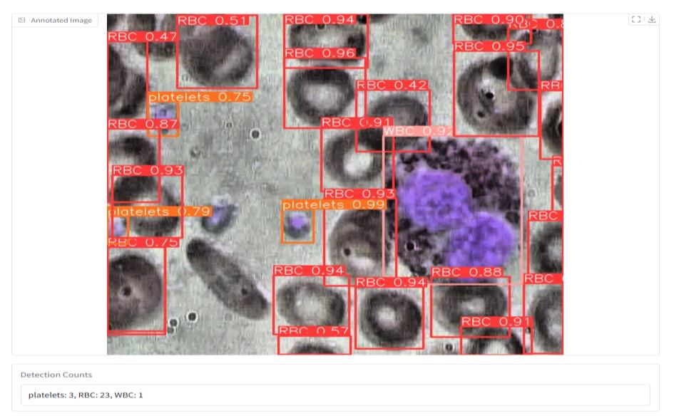
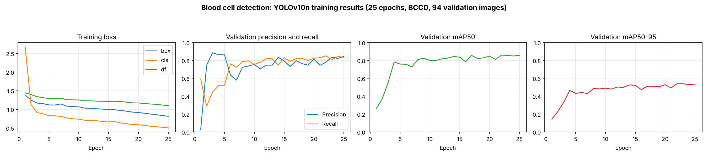
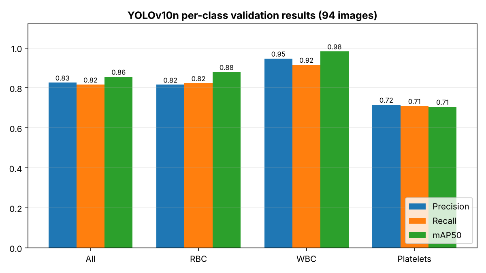
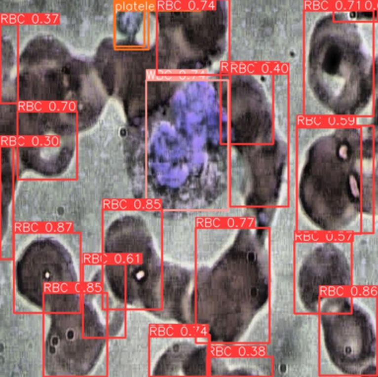

# Automated Blood Cell Detection and Counting

An AI-powered system that automatically detects and counts Red Blood Cells (RBC), White Blood Cells (WBC), and Platelets from blood smear images using YOLOv10 deep learning.

## Demo and Results

## Performance Metrics

| Metric | Score |
|--------|-------|
| mAP50 | 85.6% |
| Precision | 82.7% |
| Recall | 81.7% |
| mAP50-95 | 53.9% |
| Training Epochs | 25 |

Evaluated on the 94-image validation set. Per-class mAP50: RBC 88.0%, WBC 98.3%, Platelets 70.6%.

## Project Overview

This project implements a complete automated blood cell analysis pipeline:
- **YOLOv10** deep learning model for real-time detection
- Detects 3 cell types: RBC, WBC, and Platelets simultaneously
- **Gradio web interface** for easy image upload and real-time results
- Trained on BCCD (Blood Cell Count and Detection) dataset
- Preprocessing: images resized to 640×640
- Post-processing: cell counting per class

## System Architecture

Input (Blood Smear Image) → Preprocessing → YOLOv10 Detection → Post Processing → Output (Gradio UI)

## Technologies Used

- Python 3.x
- YOLOv10 (Ultralytics)
- OpenCV
- Gradio
- NumPy
- Matplotlib

## How to Run

Open `BloodCellCount.ipynb` in Google Colab with a GPU runtime and run all cells. The last cell starts the Gradio app.

## Dataset

BCCD Dataset — Blood Cell Count and Detection (from Roboflow)
- 3 classes: RBC, WBC, Platelets
- Validation: 94 images

## Potential Applications

- Medical diagnostics and hematology
- Early detection of anemia, leukemia, infections
- Remote healthcare and telemedicine
- Research in computational pathology

## Conference

Presented at the **Second International Conference on Futuristic Trends in Science, Engineering and Management (ICFTSEM-II) 2025**

## Authors

- Dorathisha P
- Swarna Lakshmi R
- Varshini M P

Sethu Institute of Technology, Anna University — March 2025

## Supervisor

Mrs. S. Asha M.E., (Ph.D.) — Assistant Professor, CSE
