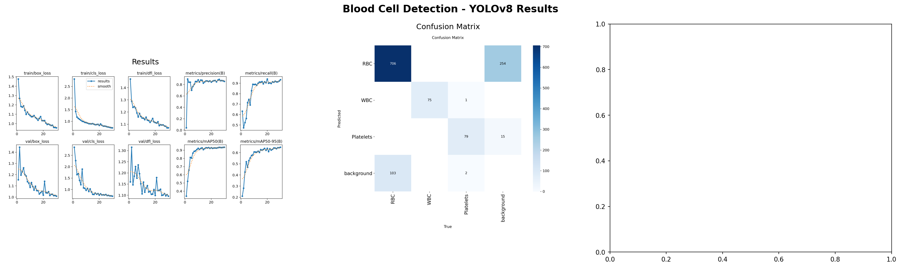
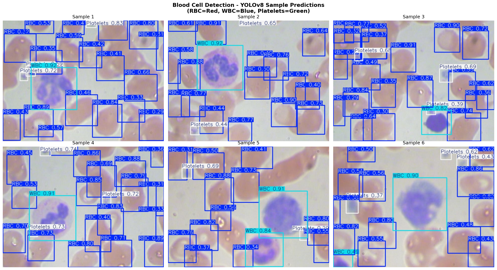

# Automated Blood Cell Detection and Counting

An AI-powered system that automatically detects and counts Red Blood Cells (RBC), White Blood Cells (WBC), and Platelets from blood smear images using YOLOv8 deep learning.

## Demo


## Results





## Performance Metrics

| Metric | Score |
|--------|-------|
| mAP50 | 93.64% |
| Precision | 85.70% |
| Recall | 93.44% |
| mAP50-95 | 64.80% |
| Training Epochs | 30 |

## Comparison with Existing Methods

| Method | Accuracy |
|--------|----------|
| Traditional Image Processing | ~85% |
| Fuzzy CNN | ~90% |
| RetinaNet | ~92% |
| CNN + VGG16 + CBAM | ~94% |
| **Our YOLOv8 System** | **93.64% mAP50** |

## Project Overview

This project implements a complete automated blood cell analysis pipeline:
- **YOLOv8** deep learning model for real-time detection
- Detects 3 cell types: RBC, WBC, and Platelets simultaneously
- **Gradio web interface** for easy image upload and real-time results
- Trained on BCCD (Blood Cell Count and Detection) dataset
- Preprocessing: noise reduction, resizing, histogram equalization
- Post-processing: cell counting and density calculation

## System Architecture

Input (Blood Smear Image) → Preprocessing → YOLOv8 Detection → Post Processing → Output (Gradio UI)

## Technologies Used

- Python 3.x
- YOLOv8 (Ultralytics)
- OpenCV
- Gradio
- NumPy
- Matplotlib

## How to Run

```bash
pip install ultralytics gradio opencv-python matplotlib
python app.py
```

Then open http://127.0.0.1:7860 in your browser and upload a blood smear image!

## Dataset

BCCD Dataset — Blood Cell Count and Detection
- 364 blood smear images
- 3 classes: RBC, WBC, Platelets
- Train: 291 images | Validation: 73 images

## Applications

- Medical diagnostics and hematology
- Early detection of anemia, leukemia, infections
- Remote healthcare and telemedicine
- Research in computational pathology

## Conference

Presented at **ICFTSEM-II 2025** — International Conference on Future Trends in Science, Engineering and Management

## Authors

- Dorathisha P (Reg.No: 921721102029)
- Swarna Lakshmi R (Reg.No: 921721102163)
- Varshini M P (Reg.No: 921721102171)

Sethu Institute of Technology, Anna University — March 2025

## Supervisor

Mrs. S. Asha M.E., (Ph.D.) — Assistant Professor, CSE
